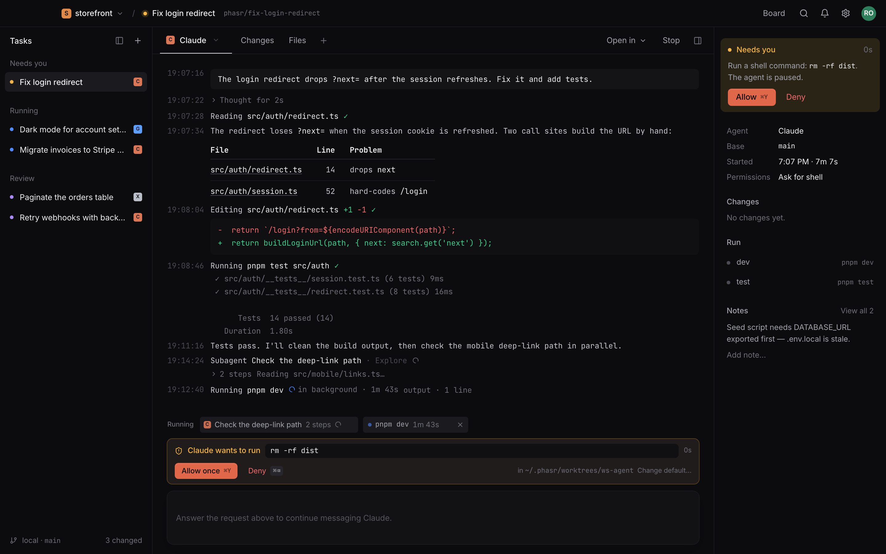
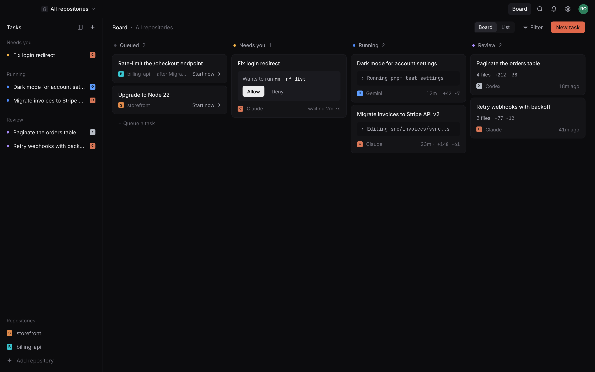
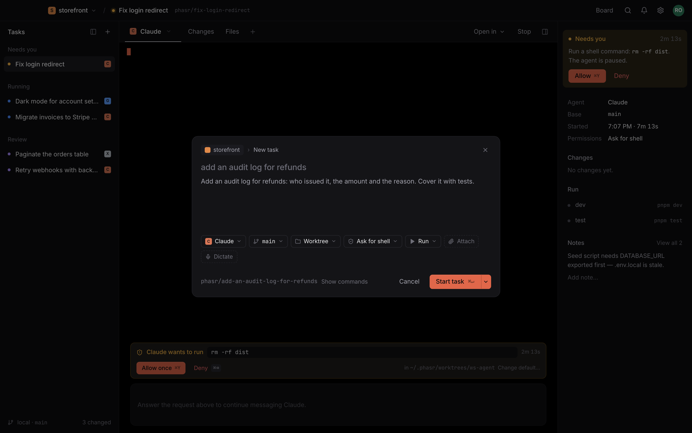
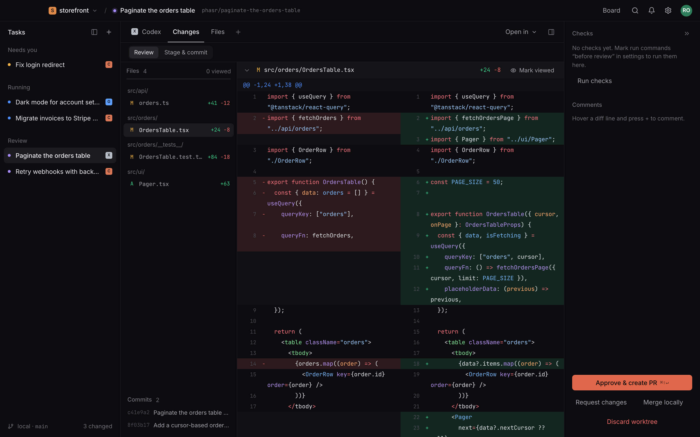
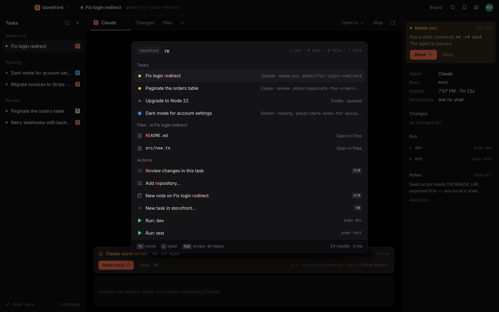

# Phasr

**Run several coding agents at once, each on its own branch in its own git worktree, and review what they did before anything touches your checkout.**

Phasr is a macOS app for running Claude Code, Codex, Copilot, Gemini and OpenCode side by side. It shows every task on one board, flags the ones waiting for you, and lets you review and ship each one with a diff, checks and a pull request.

> Pre-1.0, macOS on Apple Silicon only. Builds aren't code-signed yet (see [Install](#install-macos-apple-silicon)).



## What it does

### Every task on one board

Tasks sit in four columns: **Queued**, **Needs you**, **Running** and **Review**. A running card shows what the agent is doing right now. A blocked card shows what it wants to run, with **Allow** and **Deny** on the card itself. Review cards show how many files changed and the lines added and removed. You can filter by agent, switch to a list, and move between cards with the arrow keys.

<picture>
  <source media="(prefers-color-scheme: light)" srcset="docs/screenshots/board-light.png">
  
</picture>

### Start a task in seconds

Write what you want, then pick:

- **Agent:** any of the five that's installed.
- **Base branch.**
- **Where it runs:** a fresh **worktree**, or **in place** in your own checkout.
- **Permissions:** **Ask for edits**, **Ask for shell** (the default) or **Skip all**.

You can attach images and files, and **Show commands** lists exactly what Phasr will run. Start the task with ⌘↵, or save it as a draft.



### Work with the agent

- **Transcript view (Claude).** Claude's replies render as formatted text, including tables, links to files, and Mermaid diagrams. Edits appear as diffs and commands show their output. Thinking, subagents and background commands each get their own row.
  - Subagents and background commands also appear as chips above the composer. Click a subagent to follow it live in the side panel.
  - Suggested replies follow from what Claude just said.
  - **Stop turn** interrupts Claude without ending the task.
- **Terminal view (every agent).** A full terminal (ghostty-web). Open extra shell tabs with ⌘T.
- **Voice input.** In an empty reply box the send button is a mic (⌘⇧D works anywhere you type, New task has a Dictate chip, or just hold **fn** and talk, then let go to insert). Whisper transcribes on your Mac as you talk, so the words appear live and your voice never leaves it. The text goes in exactly as heard. If you want, **Settings → Voice** can have a fast model (Claude Haiku, or Codex's fast model, through your own login) tidy up misheard terms, punctuation and filler words after you stop.
  - The speech model isn't bundled. The first click offers a one-time download (148 MB); **Settings → Voice** has a more accurate English model and a multilingual one.
- **Approvals.** When an agent asks to run a command or edit a file, a card appears in that task: **Allow once** (⌘Y), **Allow for this task**, or **Deny** (⌘⌫).
  - Phasr also sends a short macOS notification with **Allow** and **Deny** buttons, so you can answer without switching to the app.
  - The bell icon keeps an inbox of approvals, finished tasks, failures and check results.
- **Side panel.** Shows the agent and model, base branch (with a **Sync** button when it falls behind), when the task started, token usage and cost (Claude and Codex), its run commands, and the repository's notes.

### Review and ship

The **Changes** pane lists every file the task changed against its base branch:

- **Diff:** split or unified (⌘\\). Mark each file as viewed as you go.
- **Comments:** hover a line, press **+**, and leave a comment. **Send all comments** sends them to the agent as one message.
- **Checks:** run commands marked "before review" run when the task is ready for review. Mark them **required** to block approval until they pass.
- **Ship it:** **Approve & create PR** (⌘⇧↵) pushes the branch and opens the pull request with the `gh` CLI, or opens GitHub's compare page if `gh` isn't installed. You can also **Merge locally** (merge commit, squash or fast-forward), **Request changes**, or **Discard worktree**.



### Everything else

- **Files pane.** A full editor (CodeMirror) for any file in the worktree. Switch to **Diff** to revert a single hunk. If the agent changes a file while you have unsaved edits, Phasr asks which version to keep instead of overwriting yours.
- **Run commands.** Save dev servers, tests and scripts per repository. Run them by hand, at task start, or before review.
  - Pinned commands run with ⌘1–⌘9.
  - Commands are suggested from `package.json`.
  - Once a server is listening, its port shows on the tab.
- **Command palette (⌘K).** Search tasks, files, actions and settings in one list. Narrow the search with `>` commands, `#` tasks, `@` files, `?` help.
- **Repositories.** Open an existing folder, clone a URL, start an empty repo, or use a template.
  - New worktrees can copy untracked files like `.env`, and run a setup command after they're created.
  - Branch rules can protect paths and stop Claude from pushing.
- **Settings (⌘,).** Theme (dark, light or system), accent colour, density, terminal font and shell, notifications with quiet hours, and keyboard shortcuts. API keys are stored in the macOS Keychain and never synced.



## Supported agents

| Agent | CLI | Terminal | Transcript view | In-app approvals | Usage & cost |
|---|---|:-:|:-:|:-:|:-:|
| Claude Code | `claude` | ✓ | ✓ | ✓ | ✓ |
| Codex | `codex` | ✓ | | ✓ | ✓ |
| Gemini | `gemini` | ✓ | | ✓ | |
| Copilot | `copilot` | ✓ | | ✓ | |
| OpenCode | `opencode` | ✓ | | | |

How approvals work for each agent:
- **Claude and Codex** report when they need you through hooks.
- **Gemini and Copilot** are detected by reading the terminal, so their cards say "from terminal".
- **OpenCode** only runs with **Skip all** permissions, so there's nothing to approve.

The transcript view, subagents and suggested replies are Claude-only.

## Install (macOS, Apple Silicon)

1. Download `Phasr_<version>_aarch64.dmg` from [Releases](https://github.com/irishabh96/phasr/releases).

2. Open it and drag **Phasr** into **Applications**.

3. **First launch only.** Phasr isn't code-signed yet, so macOS may say *"Phasr is damaged and can't be opened."* The app is fine; macOS has just quarantined it. Clear the quarantine flag in Terminal:

   ```sh
   xattr -dr com.apple.quarantine /Applications/Phasr.app
   ```

   Then open Phasr normally. On macOS Sequoia and later, the right-click → Open workaround no longer works for unsigned apps, so this command is the only way.

## What you'll need

- **macOS 11 or later** on Apple Silicon.
- **`git`.**
- **At least one agent CLI on your `PATH`:** `claude`, `codex`, `copilot`, `gemini` or `opencode`. Phasr detects which ones are installed; you can re-detect, or change their commands, in **Settings → Agents & keys**.
- **Optional: the [`gh`](https://cli.github.com) CLI, signed in.** **Approve & create PR** uses it to open pull requests, including on GitHub Enterprise. Without it, Phasr opens GitHub's compare page instead.
- **A Phasr account.** You sign in with Google or GitHub. Repositories, tasks (including their prompts), run commands and settings sync between your Macs. Phasr doesn't upload your code, and API keys stay in your Keychain.

## Keyboard shortcuts

| Keys | Action |
|---|---|
| ⌘N | New task |
| ⌘K | Command palette |
| ⌘P | Search files |
| ⌘T / ⌘W | New terminal / close tab |
| ⌘Y / ⌘⌫ | Allow / deny the agent's request |
| ⌘. | Stop the agent |
| ⌘⇧R | Review changes |
| ⌘\\ | Split or unified diff |
| ⌘⇧↵ | Approve & create PR (in review) |
| ⌘I | Show or hide the side panel |
| ⌘B | Collapse the task list |
| ⌘⇧N | Repository notes |
| ⌘⇧D | Dictate (↵ inserts, Esc cancels) |
| hold fn | Dictate while held; let go to insert |
| ⌘1–⌘9 | Run a pinned command |
| ⌘+ / ⌘− / ⌘0 | Terminal font size |
| ⌘, | Settings |

All shortcuts are listed in **Settings → Keyboard**. On the board, `n` starts a new task and the arrow keys (or `h` `j` `k` `l`) move between cards.

## Develop / contribute

```sh
git clone https://github.com/irishabh96/phasr
cd phasr
pnpm install
pnpm tauri dev
```

Before launching, copy `.env.example` to `.env.local` and set:
- `VITE_CLERK_PUBLISHABLE_KEY`, `VITE_SUPABASE_URL` and `VITE_SUPABASE_ANON_KEY`: required, because sign-in and sync are part of the app.
- `VITE_SENTRY_DSN`: optional. Turns on error reporting and masked session replay.

| Command | What it does |
|---|---|
| `pnpm typecheck` | TypeScript checks |
| `pnpm test` | Unit tests (Vitest) |
| `pnpm exec playwright test` | End-to-end tests against a mocked backend (Playwright; `pnpm test:e2e:webkit` for WebKit) |
| `cargo test --manifest-path src-tauri/Cargo.toml` | Rust tests |
| `pnpm check:commands` | Every Tauri command wired on both sides |
| `pnpm tauri build` | Build the app and DMG |

See [CONTRIBUTING.md](CONTRIBUTING.md) for the full setup, code layout and PR flow.

## Stack

- **Desktop shell:** Tauri 2 (Rust)
- **Frontend:** React 19, Vite, Tailwind v4, TanStack Router and Query, Zustand
- **Terminals:** ghostty-web (libghostty-vt in WebAssembly), each backed by a PTY in Rust
- **Agent transcript:** Claude Code's `stream-json` protocol
- **Editor and diagrams:** CodeMirror 6 and Mermaid, loaded only when used
- **Voice input:** whisper.cpp (Metal) through `whisper-rs`, the microphone through `cpal`
- **Local data:** SQLite via `sqlx`
- **Auth and sync:** Clerk and Supabase

## Releases

Tagging `v*` on `master` builds the Apple Silicon DMG in GitHub Actions and attaches it to a draft release. See [RELEASING.md](RELEASING.md).

## License

[MIT](LICENSE). Third-party licences are listed in [THIRD-PARTY-NOTICES.md](THIRD-PARTY-NOTICES.md).
